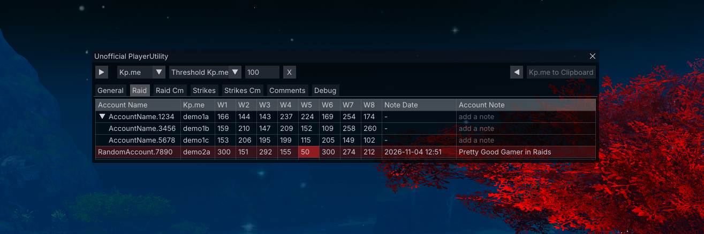
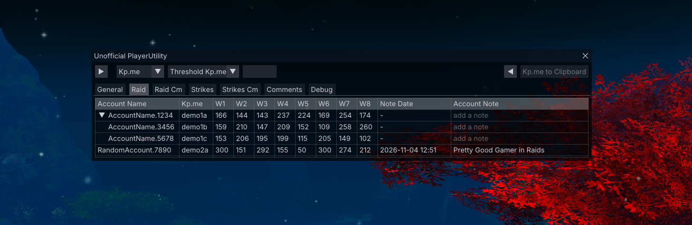

# Unofficial PlayerUtility

A [Raidcore Nexus](https://raidcore.gg/Nexus) add-on for Guild Wars 2 which is loading information
from [Killproof.me](https://killproof.me/) or [GW2 Wingman](https://gw2wingman.nevermindcreations.de/) ingame.

## Features

### Data Sources
- **Switchable Sources**: Load data from either [Killproof.me](https://killproof.me) or [GW2 Wingman](https://gw2wingman.nevermindcreations.de)
    -  Show either Tokens from Killproof.me or Successful Logs from GW2 Wingman
- **Clear Content Separation**: Raids, Raid CMs, Strikes and Strike CMs in separate tabs
- **Fractal and Raid:** Shows Legendary Insights (LI) and Unstable Fractal Essence (UFE)

### Threshold and Quick-Select
- **Threshold Highlight**: Set a minimum of e.g. Tokens or UFE you're looking for. Players below the threshold are highlighted for easier checks.
- **Quick-Select Presets**: Save the threshold values you use most so you can apply them in one click.



### Views
- **Compact View**: Shows the value of Tokens from last encounter of the Raid.
- **Expanded View**: Shows Tokens for every encounter of the Raid. Encounters are grouped by **Wing** and labeled visually so you can find them quickly.
- **Linked Accounts:**
    - Expanded: Each account gets its own row and Token values
    - Collapsed: Combined value of all linked accounts is shown. Expand the entry to see each account, or hover over the value for a quick glance via a tooltip.
- **Quick Toggle:** Switch between compact and expanded view with the arrow button in the top-left corner.



### Notes & Search
- **Account Notes:** Add a note to any account, the add-on will add the date and time the note was created.
- **Linked Account Notes:** Optionally apply a note to all linked accounts. This can be enabled or disabled in the settings.
- **Comment Search:** Search through all saved comments or account names with a search field, highlighting the matches found.

### Customization
- **Window**: Set a value of how many players should maximum be shown. After the value is reached, the window will not expand but a scrollbar will be shown to adjust to different screen sizes.
- **Tooltips**: By default the tooltips are enabled to help you navigate the add-on. Once you are familiar with it, you can disable them. **Data Tooltips** show you linked account values without having to expand them, just by hovering over the values.
- **Linked Account**: Set a default of wether accounts should be expanded or collapsed.
- **Layout**: Customize the order, width and the alignment of the columns as well as the values in the columns. Enable or disable additional UI elements for dropdown menus and change the header and row height.
- **Colors**: You can change almost any color which is used in the add-on, from background to table color, the color used to highlight either rows, columns or text. You can set whether the entire row or only the text should be highlighted and which color the search highlight should have.
- **Quick Access:** You can enable or disable a dedicated icon next to the Nexus icon, or you can use the default keybind `CTRL+SHIFT+K` to show or hide the window.

> [!NOTE]
> Please use this add-on responsibly. Don't use it to discriminate against or exclude players. Be fair and give every player a chance.

## Requirements

- [Raidcore Nexus](https://raidcore.gg/Nexus)
- [ArcDPS](https://www.deltaconnected.com/arcdps/)
- [ArcDPS - Unofficial Extras](https://github.com/Krappa322/arcdps_unofficial_extras_releases)

## Installation

1. Download `Unofficial_PlayerUtility.dll` from the [Releases](../../releases) site
2. Place the .dll into the `\Guild Wars 2\addons\` folder
3. Start the game, enable the add-on in the Nexus add-on library and restart

## Data and Privacy

To show player information the add-on sends the account names to `killproof.me` and `gw2wingman.nevermindcreations.de`. Only public data and profiles will be shown, if no profile has been created or the profile has been set to private, no data are shown. 

### Responsible Use of External Services
- **Large Groups:** No requests are sent for groups with more than ten players
- **On Demand Only:** A lookup against the selected source only happens while the add-on is open, nothing is requested in the background
- **One Request Per Account:** Each account is looked up only once
- **Sequential Requests:** Requests are sent one after another, never in parallel
- **In-Memory Caching:** Results stay in memory until the game is restarted
- **No Automatic Retries:** Failed requests are not retried
- **Identifiable Requests:** Every request includes the add-on's name and version number

The add-on creates and stores three files in `\Guild Wars 2\addons\UnofficialPlayerUtility\`, the `Settings.txt` which contains the settings which you set within the add-on, the `Player_Notes.txt` which contains all set account notes and the `Debug_Log.txt` which contains event logs. The `Debug_Log.txt` is recreated at every start and holds a max file size of ~200 KB.

## Building from Source

**Requirements**: Visual Studio 2026 (Platform Toolset v145) with the **Desktop Development with C++** workload.

```
git clone --recursive https://github.com/mdwod/Unofficial-PlayerUtility.git
```

Open `unofficial-playerutility.sln` and choose **Release | x64** and build.
The .dll is written to `x64\Unofficial_PlayerUtility.dll`. The `src/nexus`, `src/imgui` and `src/mumble` folders are Git submodules. Keep them at the pinned versions: Nexus API and ImGui versions must match the ones Nexus uses.

## Disclaimer

The use of any third-party software is at the sole discretion of the player. The developer of this addon is not responsible for any actions taken against the players account. ArenaNets policies ([Third-Party Programs](https://help.guildwars2.com/hc/en-us/articles/360013625034-Policy-Third-Party-Programs)) are subject to change without notice, please stay informed and decide for yourself whether you are comfortable with the risks of using third-party programs. 

> [!NOTE]
> This add-on was developed with the help of AI. This includes the source code and the documentation. The output and functionallity was tested and reviewed by humans.

## Credits

Not affiliated, endorsed or sponsored by ArenaNet or any of the mentioned services. 

> [!NOTE]
> ArenaNet, Guild Wars 2 and all associated assets are trademarks or registered trademarks of NCSOFT Corporation. © ArenaNet, LLC. All rights reserved. All related content and assets which are shown in the add-on are the properties of their respective owners.

- Based on the [Nexus Add-on Template](https://github.com/RaidcoreGG/Nexus-Template-cpp) by Raidcore.GG (MIT).
- [Dear ImGui](https://github.com/ocornut/imgui) (MIT), Nexus API and Mumble API headers by Raidcore.GG (MIT).
- Data from [Killproof.me](https://killproof.me) and [GW2 Wingman](https://gw2wingman.nevermindcreations.de).

## License

The [MIT](LICENSE) license only covers the source code written for this add-on. It does not cover Guild Wars 2 assets, which remain the property of ArenaNet, LLC.
